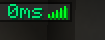
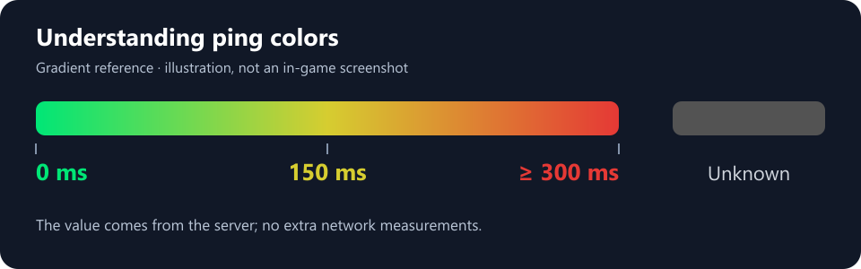

# portage-better-ping-display

Displays each player's ping in milliseconds, with latency-based colors, after their name in Horizon's **Tab player list**.

An unofficial community Rust port of **Better Ping Display — Fabric Edition**, originally created by **Vlad Marica**. The original author is credited for the original mod and is not presented as the maintainer of this port.



*Real screenshot provided by the user, showing the initial 0.1.0 release. Version 0.1.1 preserves this display and introduces the project name and documentation.*

## Installation and use

1. Install `portage-better-ping-display-0.1.1.hnmod` through your instance's Horizon native-mod integration.
2. Let that integration build the game with the mod, then launch the resulting build.
3. Open **Options → Mods** and make sure **portage-better-ping-display** is **ON**.
4. Hold **Tab** in-game, or the key assigned to the player list.

The number appears after each player's name. Connection bars remain visible. The mod does not add an indicator to the F3 debug screen.

For a Prism instance configured for native mods, the folder is `minecraft/horizon-native-mods`. Build automation depends on your integration: copying a package is enough only when the integration also handles the required build.

**Upgrading from the initial release:** remove `better_ping_display-0.1.0.hnmod`, install the new package and rebuild. The native ID is now `portage_better_ping_display`; do not enable the old and new packages together. The new mod is enabled by default and has its own toggle.

## Understanding the value



Colors form a gradient: green at 0 ms, yellow at 150 ms and red at 300 ms or above. Unknown negative values are gray.

The mod shows the **latest latency value supplied by the server**. It sends no additional ping requests. A vanilla server running at its normal tick rate generally updates this information every 600 ticks, approximately **30 seconds**. Modified or slower servers may use a different interval.

`0ms` is the value supplied by the game; it can occur during local play or before an initial measurement. It does not prove that network latency is exactly zero. The Tab display is not a continuous network measurement.

## Features and limitations

- Client-side: vanilla servers do not need this mod installed.
- Reads player-list latency and appends it to the displayed name using the original mod's color palette.
- Preserves custom display names, team and spectator formatting, and connection bars.
- Lets Horizon calculate list width; the available space also depends on window size and other displayed information.
- Can be enabled or disabled at runtime in **Options → Mods**.
- Adds no dedicated keybind, background service or network measurement traffic.

This port does not include the original YACL settings screen, `betterpingdisplay.json`, configurable colors or formats, or the original mod's exact text placement. It uses the `<value>ms` format and keeps connection bars visible.

A `.hnmod` contains Rust source and a manifest for Horizon's native build process. It is not a Fabric JAR or a dynamically loaded DLL. Adding, removing or updating a package requires rebuilding the game through your integration.

## Compatibility

| Component | Version |
| --- | --- |
| Port version | 0.1.1 |
| Native ID | `portage_better_ping_display` |
| Minecraft | 26.3 |
| Target Horizon revision | `fdc87aecdbd116bf1e08adcd062fcbaea8c2e2ca` |
| horizon-mixins revision | `e59da9094f0c2fdda6c627fe9eff22dec6a906f0` |
| License | MIT |

The port patches a player-list rendering function, so a compatible hook API number alone does not guarantee compatibility with another Nightly. See [VALIDATION.json](VALIDATION.json) for the checks actually performed. Check the current Nightly before publishing to the registry or claiming support for it.

## Documentation and source

- [User guide and troubleshooting](docs/USAGE.md)
- [Credits and provenance](docs/CREDITS.md)
- [Registry submission notes](REGISTRY.md)
- [Changelog](CHANGELOG.md)
- [Original mod by Vlad Marica](https://github.com/vladmarica/better-ping-display-fabric)
- [Original source revision used by this port](https://github.com/vladmarica/better-ping-display-fabric/tree/96ddda664ff4c4eb2e119c22d3ed6e93b1012294)

## Development

`mixins/portage_better_ping_display` contains the manifest and Rust sources. The color logic can be tested without compiling the entire game:

```powershell
cargo test
```

To produce a reproducible package with Python 3.11 or newer:

```powershell
python scripts/package.py
```

The output goes into `dist`. With the official tools available, validate it before distribution:

```powershell
cargo horizon-mod check dist/portage-better-ping-display-0.1.1.hnmod
```

To check integration, apply the bundle to the specified Horizon source revision with `horizon-mixins`, then compile the generated workspace. See the [official testing guide](https://playhorizon.dev/docs/test-a-mod).

## Credits and license

**Vlad Marica** created the original mod and its adapted color logic. The original MIT notice is preserved in [LICENSE](LICENSE). Adapted Horizon rendering code is credited to **Ludovic Marie and the Horizon contributors**, under [LICENSE-Horizon](LICENSE-Horizon).

Port maintainer: **[fanthomas-creator](https://github.com/fanthomas-creator)**. Community Rust port prepared with assistance from Codex. Exact source references are recorded in [SOURCES.json](SOURCES.json) and [NOTICE.md](NOTICE.md). This is not an official Minecraft product.

## Contributing and release authenticity

Changes go through pull requests and maintainer review. Read [CONTRIBUTING.md](CONTRIBUTING.md), the [code of conduct](CODE_OF_CONDUCT.md) and the [security policy](SECURITY.md). The lightweight CI checks formatting, independent logic and packaging; it does not claim whole-game compatibility on untested Nightlies.

Project packages are signed with minisign. The public verification key is in [signing/portage-better-ping-display.pub](signing/portage-better-ping-display.pub). Verify the package before installing it:

```powershell
minisign -V -p signing/portage-better-ping-display.pub -m dist/portage-better-ping-display-0.1.1.hnmod
```

See [release instructions](docs/RELEASING.md) and [repository rules](docs/REPOSITORY_RULES.md). Private signing material is kept outside the repository and is not available to CI.
