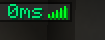
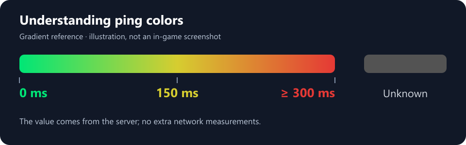

# User guide

## Installing in Horizon or Prism

Install `portage-better-ping-display-0.1.1.hnmod`. The complete project ZIP also includes source code, images and documentation; it is not a substitute for the `.hnmod` package.

For a Prism instance whose integration supports Horizon native mods:

1. Close the game before changing the build it will launch.
2. Put the package in the instance's `minecraft/horizon-native-mods` folder.
3. Remove the initial `better_ping_display-0.1.0.hnmod` package if present.
4. Run the native build, or launch the instance if its integration does this automatically.
5. Open **Options → Mods** and confirm **portage-better-ping-display** is listed and **ON**.

The executable being launched must be the one built with this mod. Placing a package in an instance folder does not add its code to an already-built executable.

## Showing ping

Hold **Tab** during a game. If you changed this binding, use the key assigned to the **player list**.

In this example, `0ms` is the value received by the client. This port keeps the connection bars next to the display.

The mod does not add a line to F3. If no list opens, check your keybind and whether Horizon would normally show the player list in that situation. The mod does not force a hidden list to open.

## Reading the colors

| Value | Reference color |
| --- | --- |
| Negative: unknown | Gray `#535353` |
| 0 ms | Green `#00E676` |
| 150 ms | Yellow `#D6CD30` |
| 300 ms or higher | Red `#E53935` |

Colors blend progressively between these points. They indicate latency and do not diagnose server health or connection stability.

## Update interval

The value comes from player information sent by the server. The mod does not schedule measurements or send additional network requests.

On a vanilla server running at 20 ticks per second, the player-list update is generally sent every 600 ticks, approximately 30 seconds. Modified or slower servers may behave differently. The client displays the new value when it arrives.

## Troubleshooting

**The game opens, but the mod is missing from Options → Mods.** The launched executable was probably not built with this package. Check the build log and the executable selected by your integration.

**The mod is listed, but there is no number.** Enable its toggle, hold the player-list key and check that the list itself is visible. The number appears after player names.

**The number does not change.** Wait for a server update. A stable value does not necessarily mean the mod has stopped working.

**The number is 0.** This is a zero value supplied by the game, which can occur locally or before an initial measurement. It does not necessarily mean a network connection with no delay.

**Ping appears twice.** Check that the initial package and this renamed port are not both built in, and that another mod is not adding its own numeric display.

**The package stops compiling after an update.** This port targets the Horizon revision stated in the README. Keep the last compatible build and inspect the error before updating the port.

## Disabling and removing

Set the mod to **OFF** in **Options → Mods** to hide its text immediately. To remove its code from the executable, remove the package from the selected mods and rebuild.

## Original author

**Better Ping Display — Fabric Edition** was created by **Vlad Marica**. See the [original repository](https://github.com/vladmarica/better-ping-display-fabric). This unofficial community Rust port for Horizon is MIT-licensed; see [credits](CREDITS.md).
